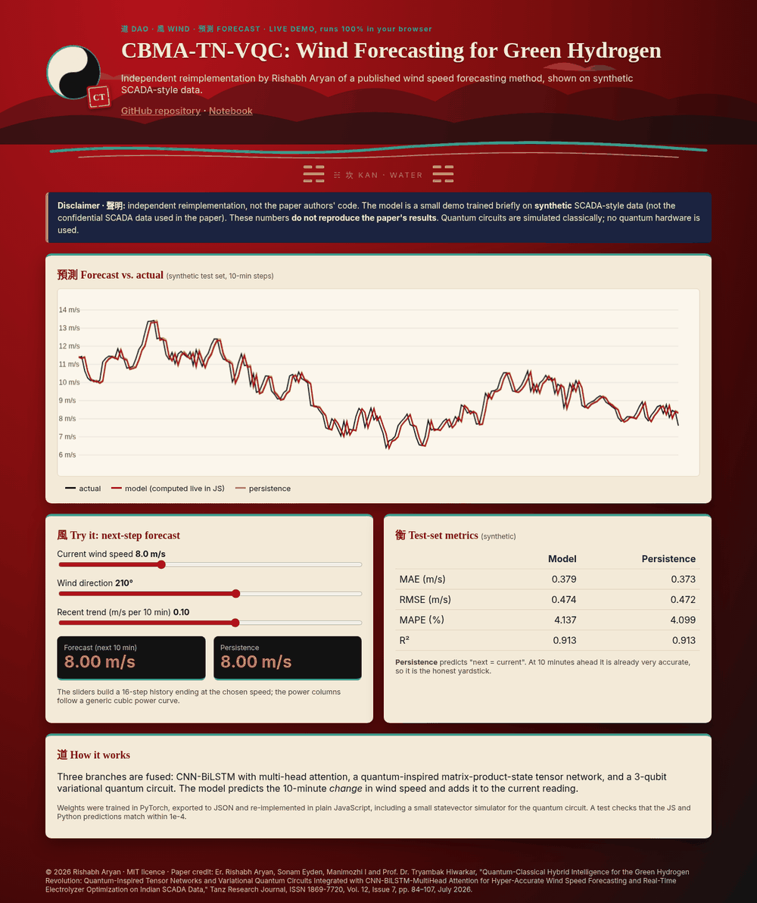

<p align="center"></p>

# CBMA-TN-VQC: Quantum-Inspired Tensor Network + VQC + CNN-BiLSTM-MultiHead Attention for Wind Forecasting and Green Hydrogen (Reimplementation)

[](https://rishabh-bgp.github.io/cbma-tn-vqc-wind-green-hydrogen/) [](https://colab.research.google.com/github/Rishabh-bgp/cbma-tn-vqc-wind-green-hydrogen/blob/main/notebooks/cbma-tn-vqc-wind-green-hydrogen_walkthrough.ipynb)

> **Independent reimplementation.** This repository is a clean, independent reimplementation of the method described in the
> paper cited below, written from the paper's text. It is **not** the original authors' code, and it does **not** use the
> paper's dataset. All quantum components run **on a classical simulator only** (PennyLane `default.qubit`, CPU, 4 qubits, 2 layers by default; the paper uses a 10-qubit, 5-layer circuit).
> Results from this code **will differ** from the published results, and the numbers reported in the paper have **not** been reproduced here.

**Keywords:** green hydrogen, wind speed forecasting, tensor network, matrix product state, variational quantum circuit, CNN-BiLSTM, multi-head attention, PEM electrolyser, quantum machine learning, PyTorch, PennyLane

## Paper · 論文

Er. Rishabh Aryan, Sonam Eyden, Manimozhi I and Prof. Dr. Tryambak Hiwarkar, "Quantum-Classical Hybrid Intelligence for the Green Hydrogen Revolution: Quantum-Inspired Tensor Networks and Variational Quantum Circuits Integrated with CNN-BiLSTM-MultiHead Attention for Hyper-Accurate Wind Speed Forecasting and Real-Time Electrolyzer Optimization on Indian SCADA Data," *Tanz Research Journal*, ISSN 1869-7720, Vol. 12, Issue 7, pp. 84–107, July 2026.

Full credit for the method goes to the paper's authors. Any simplifications or mistakes in this reimplementation are mine.

## Method · 方法

Three branches are fused into one regression head:

1. **CBMA branch:** Conv1D → BiLSTM → multi-head self-attention, mean-pooled over time.
2. **Quantum-inspired tensor network (TN):** each time step is mapped to a 2-dimensional feature vector [cos θ, sin θ] and contracted through a Matrix Product State chain (bond dimension 8). This is classical tensor-network maths, not a quantum circuit.
3. **VQC branch:** the CBMA context is angle-encoded into a simulated variational quantum circuit (RY/RZ layers, circular CNOT), read out as ⟨Z⟩.

`train.py` then turns the wind forecast into power through a cubic power curve and feeds it to a **toy PEM electrolyser model** (part-load efficiency curve, HHV 39.4 kWh/kg) to report forecast-informed hydrogen output. That model is a simple illustration, not the paper's Butler–Volmer/thermal electrolyser model or its LCOH optimiser.

## Architecture · 架構

```
x (B,T,5) ─┬→ Conv1D→BiLSTM→MultiHeadAttn→mean ─→ c (32) ─→ VQC → ⟨Z⟩ (Q)
            └→ MPS tensor network (bond 8) ────────→ t (8)
 concat[c, t, ⟨Z⟩] → Dense(→32→1) → ŷ → power curve → toy electrolyser → H₂ kg/h
```

## Data · 數據

The original SCADA data used in the paper is confidential and **not publicly available**, so it is not included here (everything in `data/` except the bundled synthetic CSV is git-ignored). The original code was not available either.
`src/data.py` provides:

- `load_scada_csv(path)`: loads a SCADA-style CSV with columns for timestamp, wind speed (m/s), wind direction (°),
  theoretical power and active power. It accepts both snake_case names (`timestamp, wind_speed, wind_direction,
  theoretical_power, active_power`) and the common Kaggle-style headers
  (`Date/Time, LV ActivePower (kW), Wind Speed (m/s), Theoretical_Power_Curve (KWh), Wind Direction (°)`).
- `synthetic_scada(n)`: an offline synthetic fallback (diurnal + weekly cycles, AR(1) turbulence, a cubic power curve and
  noisy active power). It is generated by script, so no download or account is needed:
  `python scripts/make_synthetic.py --n 3000`.

**Bundled synthetic dataset:** `data/synthetic/synthetic_scada.csv` (1500 rows, 10-minute steps, seed 0) is **synthetic data generated by `scripts/make_synthetic.py`**. It is **not** the confidential SCADA data used in the paper and has no connection to any real wind farm. `train.py` uses it by default. To use your own data locally, pass `--csv path/to/scada.csv`. Anything else you put in `data/` is git-ignored, so real data is never committed.

Features per time step are wind speed, sin/cos of direction, theoretical power and active power (kW/1000), standardised
on the training split. The target is wind speed `horizon` steps ahead. The data is split chronologically 70/15/15.

## How to run · 運行

```bash
python -m venv .venv && source .venv/bin/activate
pip install -r requirements.txt

# quick smoke test on the built-in synthetic data
python train.py --epochs 2

# full run on your own SCADA-style CSV
python train.py --csv path/to/scada.csv --epochs 30 --qubits 6
```

The script prints and saves (`results/*_metrics.json`) **MAE, RMSE, MAPE and R²** on the chronological test split, plus a
naive persistence baseline for comparison. MAPE uses a 0.5 m/s floor in the denominator so calm periods don't blow it up.

## Smoke-test results (synthetic data only) · 測試

These come from a deliberately tiny run (2 epochs, 1,500 synthetic rows, 4 qubits, seed 42) on **synthetic data**, just to check that the pipeline works
end to end. They say nothing about the method's real accuracy. At this budget the model has not converged and is **worse than persistence**.

| Metric | Model | Persistence |
|---|---|---|
| MAE | 1.064 | 0.375 |
| RMSE | 1.315 | 0.474 |
| MAPE (%) | 11.241 | 4.106 |
| R² | 0.325 | 0.912 |

## Live demo · 演示

**[https://rishabh-bgp.github.io/cbma-tn-vqc-wind-green-hydrogen/](https://rishabh-bgp.github.io/cbma-tn-vqc-wind-green-hydrogen/)** runs entirely in your browser. A small version of the model (trained briefly on the bundled synthetic CSV to predict the 10-minute change in wind speed) is exported to JSON by `web/export_model.py`, and its forward pass is re-implemented in plain JavaScript (`site/model.js`), including a small statevector simulator for the quantum circuit. `tests/test_js_parity.py` checks that the JS and PyTorch predictions agree within 1e-4. The page shows a forecast chart against persistence, sliders for wind inputs, the metrics and the disclaimer.



## Notebook · 筆記本

[`notebooks/cbma-tn-vqc-wind-green-hydrogen_walkthrough.ipynb`](notebooks/cbma-tn-vqc-wind-green-hydrogen_walkthrough.ipynb) [](https://colab.research.google.com/github/Rishabh-bgp/cbma-tn-vqc-wind-green-hydrogen/blob/main/notebooks/cbma-tn-vqc-wind-green-hydrogen_walkthrough.ipynb) is a short, beginner-friendly walkthrough: load the synthetic CSV, quick EDA plots, a small version of the model, brief training and a comparison with a persistence baseline. It works when opened on its own in Colab (it fetches the repo code and data). It uses **synthetic data only** and does **not** reproduce the paper's results.

## Tests · 測試

```bash
pytest -q
```

## Repository layout · 結構

```
├── train.py              # train + evaluate (MAE/RMSE/MAPE/R²)
├── scripts/make_synthetic.py
├── src/
│   ├── data.py           # SCADA CSV loader, synthetic generator, windowing
│   ├── metrics.py
│   ├── qlayer.py         # simulator-only VQC (PennyLane)
│   ├── train_common.py
│   └── cbma_tn_vqc.py
├── requirements.txt  LICENSE  .gitignore
```

## Limitations · 局限

- The source PDF is a scanned document; the method was read from the page images, so some details (e.g. exact layer sizes) are my interpretation.
- Electrolyser and LCOH results in the paper are not reproduced; only a toy dispatch is included.
- Quantum hardware noise and ZNE experiments are not implemented.
- Simulated quantum circuits scale exponentially with qubit count, so the defaults use few qubits. Larger settings will be slow on CPU.

## Licence · 許可

MIT © 2026 Rishabh Aryan. See [LICENSE](LICENSE). The paper itself remains under its publisher's terms.

## Other repositories by Rishabh Aryan · 其他

- [beed-ml-study](https://github.com/Rishabh-bgp/beed-ml-study)
- [pan-cancer-classification](https://github.com/Rishabh-bgp/pan-cancer-classification)
- [spam-scan](https://github.com/Rishabh-bgp/spam-scan)
- [real-estate-valuation-taiwan](https://github.com/Rishabh-bgp/real-estate-valuation-taiwan)
- [boston-house-price-prediction](https://github.com/Rishabh-bgp/boston-house-price-prediction)
- [california-house-price-prediction](https://github.com/Rishabh-bgp/california-house-price-prediction)
- [iris-classification](https://github.com/Rishabh-bgp/iris-classification)
- [machine-learning-part-1](https://github.com/Rishabh-bgp/machine-learning-part-1)
- [All repositories](https://github.com/Rishabh-bgp?tab=repositories)
